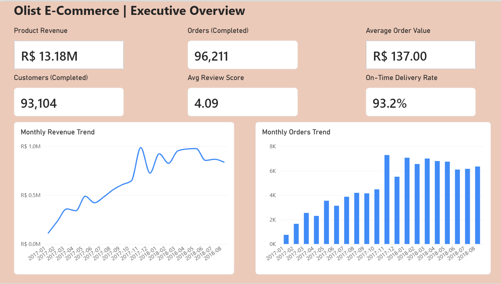

# olist-ecommerce-powerbi-dashboard
Interactive Power BI dashboard analyzing Olist e-commerce sales, products, geography, delivery performance, customer retention, and payments.

# Olist E-Commerce Sales & Business Performance Dashboard

## Project Overview
This project presents an interactive Power BI dashboard built to analyze Brazilian e-commerce business performance using the Olist dataset. It provides insights into sales, product categories, geographic performance, delivery efficiency, customer retention, and payment behavior.

## Tools & Technologies
- Microsoft Power BI
- Power Query for data preparation
- DAX for measures and KPIs
- Data visualization and business analysis

## Dashboard Pages

### 1. Executive Overview
- Product revenue and completed orders
- Average order value
- Customer count and average review score
- On-time delivery performance
- Monthly revenue and order trends

### 2. Product & Category Analysis
- Items sold and products sold
- Average item price and freight percentage
- Top product categories by revenue
- Product price versus review score
- Category-level performance table

### 3. Geography Analysis
- Revenue by geographic region
- Delivery-location map
- State-level revenue and order performance
- Revenue per customer and delivery metrics

### 4. Delivery Performance
- Late and on-time delivery rates
- Average delivery and estimated delivery days
- Late delivery trends by state and month
- Delivery performance by region

### 5. Customer Insights & Retention
- Total and repeat customers
- Repeat customer rate
- Average orders per customer
- Customer review score distribution
- Revenue by customer type

### 6. Payment & Sales Analysis
- Total payment value and average payment value
- Payment method distribution
- Payment value by installment count
- Orders by payment method

## Key Business Metrics
- Product Revenue: R$ 13.18M
- Completed Orders: 96,211
- Customers: 93,104
- Average Order Value: R$ 137.00
- Average Review Score: 4.09
- On-Time Delivery Rate: 93.2%
- Repeat Customer Rate: Approximately 3.0%

*Metrics reflect the current dashboard and should be interpreted according to the project's data definitions and filters.*

## Business Value
The dashboard helps stakeholders explore sales performance, identify high-revenue product categories and regions, monitor delivery issues, understand customer retention, and compare payment behavior.

## Project Structure
- `README.md` — Project documentation
- `Olist1.pdf` — Exported dashboard report (if included)
- Power BI `.pbix` file — Interactive dashboard source (if included)

## Dashboard Preview

**Project:** Olist E-Commerce Sales & Business Performance Dashboard

**Tools:** Power BI, Power Query, DAX

**Dashboard Pages:**
- Executive Overview
- Product & Category Analysis
- Geography Analysis
- Delivery Performance
- Customer Insights & Retention
- Payment & Sales Analysis

### View the Report
[Open the PDF Dashboard](./Olist1.pdf)

### Interactive Version
Download the `.pbix` file from this repository and open it in Power BI Desktop.

## Author
Data Analytics Portfolio Project

**Tools:** Power BI | Power Query | DAX | Data Visualization
